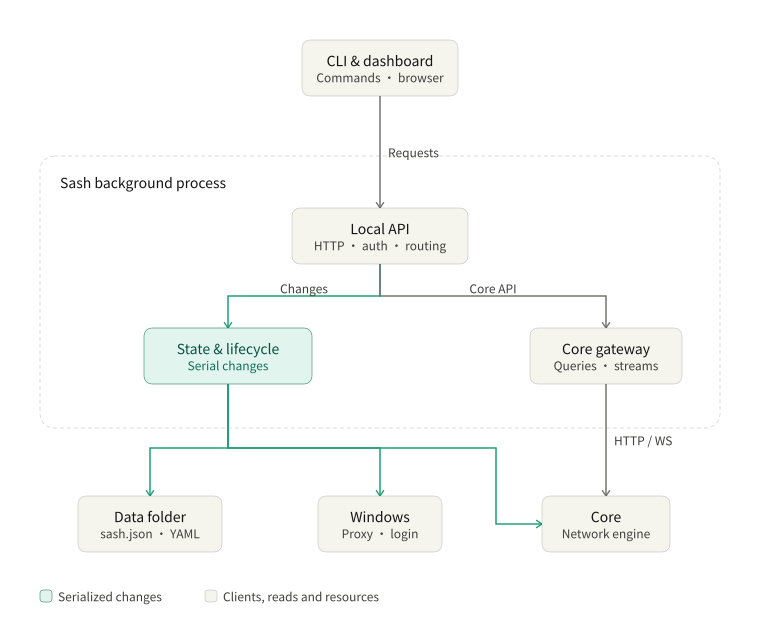

# Backend Architecture

Sash runs one background process per data folder. The CLI and dashboard use its local API; the process owns saved state and manages Core.

[Usage](./usage.md) · [Frontend](./frontend.md) · [Start at login](./autostart.md)

## Process model

[daemon/entry.ts](../src/daemon/entry.ts) acquires the instance lock, loads state, recovers interrupted Core/proxy operations, then opens the listener — the local API and dashboard work whether Core exists or not. [daemon/app.ts](../src/daemon/app.ts) wires the services; [DaemonGate](../src/daemon/context.ts) serializes saved-state and lifecycle mutations in memory while reads and live Core requests run independently. Preparation stays outside the queue: a prepared candidate is published only if the profile/restart-requiring target and runtime epoch it was built against are still current.

Process locks coordinate instance startup and per-user Windows operations; ordinary writes use the in-memory queue. Lock contenders hold unique bakery tickets, so recovering a dead owner cannot evict a successor's lock.

## Saved state

`sash.json` is the committed state; profile source text lives under `profiles/<id>/`. [SashStateStore](../src/app-state.ts) holds one frozen committed state, replaced only after a successful atomic write, with `sash.json.bak` as the recovery copy. Saves carry the revision they were read from — stale saves return `409` — and profile reads return raw text so damaged YAML can be repaired in the editor. Parsing and rendering run in a worker.

`runtime/config.yaml` is generated from the saved profile (or a DIRECT-only default) and never written back into it. Sash owns the listener, controller credentials, LAN flag and the whole `tun` section of the generated config.

## Apply: save → validate → apply

The ordering invariants:

1. Build a candidate and run Core's own configuration check **outside** the mutation queue; before applying, re-check that the profile revision, restart-requiring settings and runtime it was built for still hold. Unrelated metadata edits must not invalidate a candidate.
2. When only the profile changed, publish the core config and ask Core to reload in place — it swaps proxies, rules and DNS while established connections keep their outbound.
3. Otherwise restart: restore the prior system proxy, stop Core, verify the controller port is free, publish the config, start Core and wait for its controller to report the expected version, then apply the saved system-proxy preference.

Failure semantics follow from the ordering: a rejected reload restores the previous on-disk config and leaves the previous configuration applied; a failed restart starts the previously running configuration again and reports which configuration is back in service, so the saved edits stay pending; a failed start of a stopped Core preserves saved edits and keeps the local API available. A saved TUN preference that Core could not start is the one edit rolled back, to what is running. Geodata-only validation failures retry through mirrors, then Sash seeds the missing databases through its verified release pipeline — the configuration that passes is the one applied.

Stopping Core cancels in-flight preparation and pending reloads; shutdown also cancels downloads and drains queued work before restoring the proxy. Unexpected Core exits trigger bounded proxy-restoration retries.

## TUN Mode

TUN changes only *how Core gets privilege* — the controller, reloads, logs and Apply are identical. [CoreSupervisor](../src/supervisor.ts) drives one [CoreRunner](../src/core-runner.ts): a spawned child, or on Windows a Core started by the TUN service. [TunService](../src/tun-service.ts) reports the helper as `unsupported`, `ready`, `missing`, `stale` or `unknown` — that is all `GET /sash/tun` and the event feed carry; whether TUN is saved, applied or pending is read from status through `tunApplyState` in [contracts.ts](../src/contracts.ts). Apply refuses TUN before stopping a running Core unless it is `ready`.

Each platform acts on the managed `bin/mihomo` itself, so no Core version is pinned:

- **Windows:** a LocalSystem service built from `helper/` owns start/stop. Core path, data folder, configuration and log paths are fixed service arguments; its pipe admits only the installing account and accepts only `status`/`start`/`stop` — it never takes a path, arguments or configuration, so `sash update` needs no reinstall. Core runs inside a kill-on-close job and cannot outlive the service.
- **macOS:** the Core file is setuid root; **Linux:** it carries `cap_net_admin,cap_net_bind_service`. A Core update replaces the file and drops the grant, so `helper install` must run again.

`protocolVersion` in [helper/server.go](../helper/server.go) and `HELPER_PROTOCOL` in [tun-platform/helper-pipe.ts](../src/tun-platform/helper-pipe.ts) must change together, and only when the request or reply shape changes — Sash reports a protocol mismatch as needing reinstall, so such a change belongs in the changelog. [RELEASING.md](../RELEASING.md) covers how the helper is published.

## Updates

Both downloads are daemon-owned operations, not properties of the command that asked for them.

- **Core** ([core-update.ts](../src/core-update.ts)): official release metadata selects the artifact; HTTPS origins and redirects are allowlisted; the archive is checked against the release API's SHA-256 while streaming; extraction rejects path traversal. Progress is journaled so startup recovers interrupted replacements, and the previous binary survives until the new Core passes its health check. A running update prepares against the *applied* configuration so pending saved edits stay pending; a stopped update prepares the *saved* one. `DELETE /sash/core/update` cancels and discards the stage; only the operation still owning the observable progress may clear it.
- **Transport:** one choice per operation — a proxy variable inherited at startup, else the running Core's own port, else direct with mirrors. The digest always comes from the release API, so a mirror or proxy transport cannot change what gets installed.
- **Sash package** ([self-upgrade.ts](../src/self-upgrade.ts)): npm installs one exact version while Sash keeps running, then Sash restarts to load it. npm owns package integrity; a failed install leaves the running instance available.

## Local API

The listener binds to `127.0.0.1`. [routes.ts](../src/daemon/routes.ts) enumerates routes; [contracts.ts](../src/contracts.ts) and [SashClient](../src/sash-client.ts) define the wire types.

Authorization: health, status and proxy observations are public reads; private profile URLs always need the bearer; everything else accepts either the CLI bearer or browser same-origin evidence (`Origin` equal to the loopback `Host`, or `Sec-Fetch-Site: same-origin` without `Origin`). A presented bearer must be valid. Errors are `{error: {code, message}}` with optional `error.presentation: {message, advice?}` for CLI display; the top-level error `message` remains the raw wire message. Empty success is `204`.

Status projects saved vs. running state through `configuration: {pending, pendingChanges, applyMethod, appliedProfile, appliedSettings}`; `daemon.bootId` identifies the process and `revisions.state`/`revisions.runtime` track saved and binary changes — clients key their refreshes off these. SSE sends full snapshots from one shared observer; slow clients retain only the newest pending snapshot.

## Security boundaries

- **Processes:** verify the executable path before signaling a PID; uncertain ownership preserves the process record.
- **Transport:** check loopback `Host`/`Origin` at HTTP and WebSocket entry; controller traffic always goes direct, independently of download-proxy settings.
- **Credentials:** the browser holds no credential — provenance is what the browser enforces, so nothing exists to hand off, expire or revoke, and every local account is inside the trust boundary. Child environments are scrubbed; only Sash itself receives `GITHUB_TOKEN`/`GH_TOKEN` for release downloads.
- **Persistence:** state writes go through [fs-atomic.ts](../src/fs-atomic.ts); private state and logs use `0600` and never follow symlinks on append.
- **System proxy:** capture/apply OS snapshots only; targets, ownership comparisons and status projection are pure functions. Restore only values Sash still owns, preserving later changes by other applications; a per-user lock coordinates different data folders. See [Automatic Startup](./autostart.md) for the login registration.
