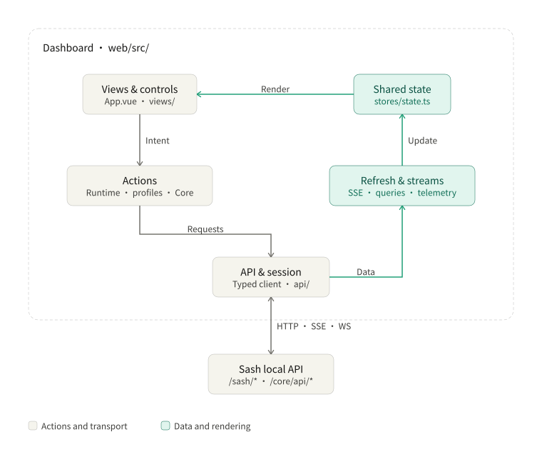

# Frontend Architecture

The Vue 3 / Vite dashboard lives in `web/src/`, builds to `dist/ui/` and is served by Sash at `/ui/`.

[Usage](./usage.md) · [Backend](./backend.md) · [Start at login](./autostart.md)



## State and actions

[stores/state.ts](../web/src/stores/state.ts) holds shared shallow-reactive state; large collections are replaced by reference. [stores/index.ts](../web/src/stores/index.ts) exposes actions and selectors to views.

Refreshes follow three values from Sash: `daemon.bootId` reconnects to the new Sash process and resets saved-state comparisons; `revisions.state` refreshes profile metadata; `daemon.bootId` + `revisions.runtime` clears the replaced Core's resources, traffic and manual latency results.

Each Core resource has its own loading state and error. A failed query preserves that resource's previous data and marks it stale; other resources remain usable. Stopping or replacing Core clears its data.

## Refresh and streams

Sash status arrives through authenticated SSE at `/sash/events`; a connection starts with a full snapshot. Core tables refresh on a two-second schedule scoped to the current page.

Page entry loads the relevant resources immediately. Saving a profile refreshes metadata and applies it to the running Core; Apply refreshes visible Core resources after replacement. Traffic uses one shared WebSocket scoped to the authorized, healthy Core runtime and keeps appending history while the tab is hidden. Visible bursts are committed at most every 100ms, while hidden tabs retain every frame. Logs still pause when hidden; both streams stop when the session or Core is unavailable. A traffic disconnect cancels any pending rate and clears the displayed rate without immediately erasing recent history.

Unchanged proxy data retains its references. Lists use memoization, pagination or batched content visibility where useful; off-screen proxy nodes are skipped in groups of 24 rather than observed card by card. Logs are batched and capped at 600 rows. Routes, the YAML editor and font slices load on demand. Full-screen interactive overlays avoid live `backdrop-filter`, and page-entry motion does not create scrollable overflow on 100%-height views. Group latency checks run at most eight node requests concurrently and publish each result as it settles instead of waiting for the whole group.

## Views and controls

[App.vue](../web/src/App.vue) owns the session gate, runtime banner and shared stream lifetime. [AppSidebar.vue](../web/src/components/AppSidebar.vue) keeps primary navigation, a compact Core state and the Apply prompt; live traffic and uptime stay on Overview instead of being duplicated in the sidebar. Pages cover Overview, Profiles, Logs, Connections, Rules and Settings.

[CoreControls.vue](../web/src/components/CoreControls.vue) shares start, stop and Apply behavior through [useCoreControl](../web/src/composables/core-runtime.ts). Applying a profile reloads the running Core and keeps established connections, so it no longer asks for confirmation; a proxy port or LAN change still restarts Core.

Notifications stay out of the way of page content. Saved changes that a running Core has not applied show an Apply prompt beside the sidebar's Core state; on phones it rests above the bottom navigation, and pages reserve its height. A stopped Core shows no prompt because Start applies the saved configuration. The banner above pages reports only an offline Sash or unavailable Core data. Toasts rise from the bottom corner for failures and for outcomes the page cannot show by itself; a change already visible in place, such as a switch, the selected node or the profile order, gets none. Confirmations fade within a few seconds, errors stay until dismissed, and at most three are shown.

Profiles shows the saved selection; Overview shows the configuration Core is using. The editor saves against the content revision read on open. Settings drafts stay local until Save and survive status refreshes. The system-proxy switch acts immediately and remains available for restoration when Core is stopped.

Shared dialogs provide focus trapping, Escape handling and focus return. The dashboard supports Chinese/English, light/dark themes and mobile navigation. Dense interface text uses system and monospace fonts; the bundled LXGW font is reserved for the Sash wordmark. Motion is brief and follows the system's reduced-motion preference.

## Authorization and transport

[api/session.ts](../web/src/api/session.ts) consumes the one-time handoff from `sash web`, removes it from the URL and stores the resulting session in `sessionStorage`. If storage is unavailable, the current page keeps the session in memory. A bare dashboard URL displays connection instructions.

[api/index.ts](../web/src/api/index.ts) uses the browser-safe [SashClient](../src/sash-client.ts). HTTP and SSE carry `X-Sash-Token`; WebSockets use a private authentication subprotocol. Sash forwards Core requests using its own controller credential.

SSE checks stream framing, sequence and process identity. Traffic/log frames are bounded and checked before entering shared state. Reconnects release old readers and ignore frames from replaced runtimes. Existing sessions can continue across Sash restarts.

## Development and verification

From a source checkout:

```sh
node scripts/dev.mjs web      # open the development dashboard
node scripts/dev.mjs build    # rebuild after UI edits, then refresh
node scripts/dev.mjs stop     # stop before loading backend changes
node scripts/dev.mjs web
```

The launcher uses a separate `-dev` data folder and initial ports `18890`, `18990` and `28990`; set an absolute `SASH_DEV_HOME` to choose another folder. `web` starts Sash; `restart` applies the saved configuration and starts Core.

After code changes, run `npm run typecheck`, `npm run lint` and affected tests; after building, run `npm run smoke:ui` plus the relevant browser check (`verify:ui`, `verify:ui:profiles`, `verify:ui:auth` or `verify:ui:autostart`). Browser checks share [ui-harness.mts](../scripts/ui-harness.mts) with temporary data, non-default ports and Core/OS fixtures; check both Chromium and Firefox. [ui-shot.mjs](../scripts/ui-shot.mjs) captures routes for visual inspection.

Font build setup lives in [build-ui.mjs](../scripts/build-ui.mjs). Bundled licenses are in [THIRD_PARTY_NOTICES.md](../THIRD_PARTY_NOTICES.md) and [remix-icon-license.txt](./remix-icon-license.txt).
