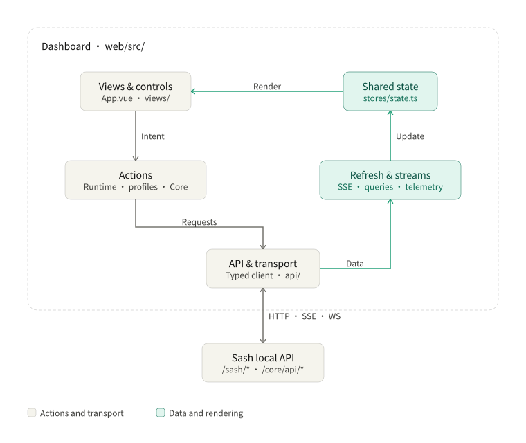

# Frontend Architecture

The Vue 3 / Vite dashboard lives in `web/src/`, builds to `dist/ui/` and is served by Sash at `/ui/`.

[Usage](./usage.md) · [Backend](./backend.md) · [Start at login](./autostart.md)

## State and refresh

[stores/state.ts](../web/src/stores/state.ts) holds shared shallow-reactive state; [stores/index.ts](../web/src/stores/index.ts) exposes actions and selectors to views.

Refresh is keyed on three values from status: `daemon.bootId` reconnects to a new Sash process and resets saved-state comparisons; `revisions.state` refreshes profile metadata; `bootId` + `revisions.runtime` clears a replaced Core's resources, traffic and latency results.

Each Core resource keeps its own loading and error state: a failed query marks that resource's data stale instead of blanking it, and other resources stay usable. Stopping or replacing Core clears its data.

## Streams

Status arrives over SSE (`/sash/events`), opening with a full snapshot — reconnection always restarts from a complete state. Core tables poll on a schedule scoped to the open page. Traffic uses one shared WebSocket per Core runtime: it keeps appending history while the tab is hidden and throttles commits while visible; logs pause when hidden. Streams stop when Sash or Core is unavailable.

Inbound frames are framing-, sequence- and process-checked before entering shared state, and reconnects discard data from replaced runtimes.

## Views

Pages cover Overview (preferences, proxy port and runtime — there is no separate Settings page), Profiles, Logs, Connections and Rules. Cross-cutting behaviors worth knowing:

- Saved-but-unapplied changes raise an Apply prompt by the sidebar's Core state; a stopped Core shows none because Start applies the saved configuration. The prompt and reload control derive their copy from `configuration.pendingChanges` and `configuration.applyMethod`, so they can distinguish in-place reloads from connection-dropping restarts.
- The editor saves against the content revision read on open, so a concurrent edit fails rather than silently overwriting — reopen before saving again.
- Toasts report only outcomes the page cannot show in place; a change already visible in the UI gets none.
- Long lists paginate or virtualize; routes, the YAML editor and font slices load on demand.
- Chinese/English, light/dark, mobile navigation, and reduced-motion are supported throughout.

## Authorization and transport

The dashboard holds no credential — the browser marks its requests same-origin and Sash admits them on that evidence (see [Local API](./backend.md#local-api)), so every tab, bookmark and reload just works. `store.connection` is `connecting` until the first SSE snapshot makes it `connected`; a failed stream makes it `offline` and a `401` makes it `refused` — [ConnectionView.vue](../web/src/views/ConnectionView.vue) renders both with the `sash web` recovery hint.

[api/index.ts](../web/src/api/index.ts) uses the browser-safe [SashClient](../src/sash-client.ts) without a token; Sash forwards Core requests with its own controller credential.

## Development

`node scripts/dev.mjs web` runs a development instance in its own `-dev` data folder; `build` rebuilds the UI; `stop` before loading backend changes. After edits: `npm run typecheck`, `npm run lint` and affected tests; after building: `npm run smoke:ui` plus the relevant `verify:ui*` browser check, in **both Chromium and Firefox** — [ui-harness.mts](../scripts/ui-harness.mts) provides the shared fixtures and [ui-shot.mjs](../scripts/ui-shot.mjs) captures routes for visual inspection.

Bundled license texts are generated into `dist/ui/licenses/` at build time, with upstream license comments preserved inside the bundled assets; the Remix Icon license ships as [remix-icon-license.txt](./remix-icon-license.txt).
